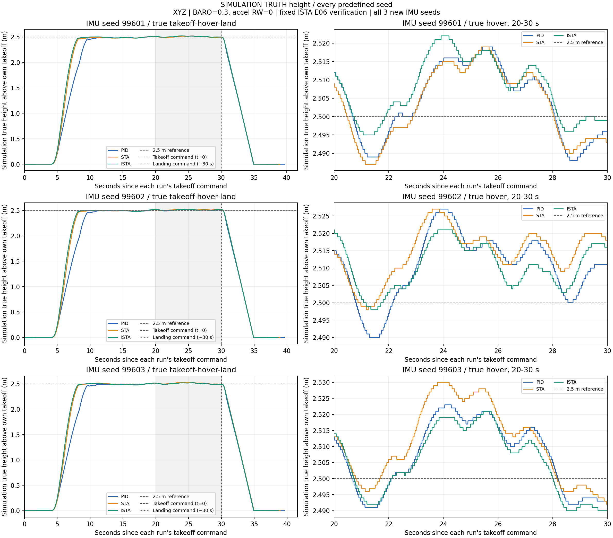
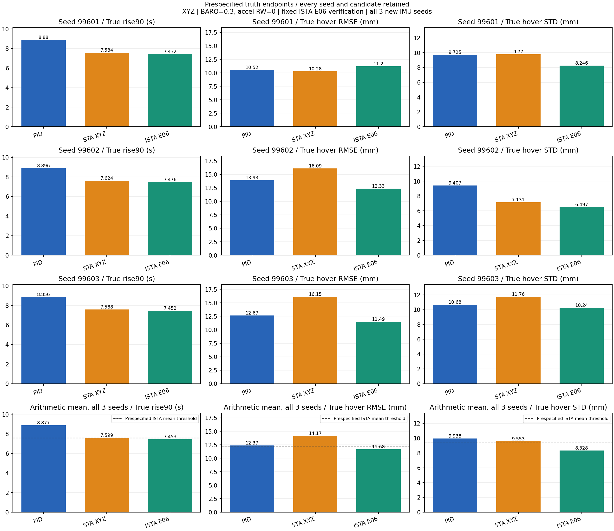

# E06：记住这组起飞—悬停—降落参数

2026-11-05 完成新9轮 Iris Gazebo SITL：PID、STA、ISTA 各3轮，全部接受并独立回放一致。用户要求将这组参数保存并 push；本目录是参数/证据档案，**不改变固件默认值，不自动加载或起飞**。

## 固定参数与适用环境

图中 STA 指 R-STA，ISTA 指补偿正则化 R-ISTA，不是 Proper-ISTA。

| 参数 | ISTA X/Y | ISTA Z |
|---|---:|---:|
| `MPC_VC_L1_*` | 0.55 | **3.3** |
| `MPC_VC_L2_*` | 0.11 | **1.56** |
| `MPC_VC_EPS_*` | 0.01 | **0.06** |
| `MPC_VC_NU_*` | 0.4 | 4 |
| `MPC_VC_A_*` | 0.8 | 6 |

ISTA 使用 `MPC_VC_MODE=4`、`MPC_VC_AXES=7`；原位置 P、姿态及角速度 PID 不变；`MPC_VC_DIV=MC_RTC_DIV=1`、`MC_RTC_MODE=0`、`MC_STA_AXES=0`、`MC_RATT_TEST=0`、`MC_STA_TKO_MGT=0`。

共同条件：`EKF2_BARO_NOISE=0.3`、`EKF2_ACC_B_NOISE=0.003`、`NAV_MC_ALT_RAD=0.1`；Gazebo 模型的加速度随机游走为 **0**，但其他噪声保留。随机游走不是 PX4 参数，仅导入 JSON 不能重现这个模型条件。起飞约2.5 m，起飞命令后30 s降落，悬停统计窗口固定20–30 s。

三个完整启动覆盖参数集合（不是只记三个增益，也不是全固件默认参数备份）：

- [ISTA E06 XYZ](parameters/ISTA_E06_XYZ.json)
- [STA XYZ 参照](parameters/STA_XYZ.json)：X/Y 为 0.45/0.09/0.01，Z 为 3/1.3/0.04。
- [PID 参照](parameters/PID.json)

JSON 包含实验接线参数 `MPC_VCT_TEST=5`，不是通用飞行配置，不应直接用于实机或不匹配版本。实验结束已恢复原 EEPROM，没有永久安装 E06。

已有配置的一个差异必须保留披露：PID 的 `MPC_Z_VEL_I_ACC=1.1`，STA/ISTA 起飞前使用的原速度 PID 对应值为 `2.2`。不能把这批结果描述成除了非线性公式外所有阶段参数完全相同。`MPC_USE_HTE=1`；RW0 不等于关闭全部 IMU 噪声或初始偏置。

## 结果：三次均值，不挑最佳轮

| 指标，越小越好 | PID | STA | ISTA E06 |
|---|---:|---:|---:|
| 真值上升90%到达时间（s） | 8.877333 | 7.598667 | **7.453333** |
| 真值悬停高度 RMSE（mm） | 12.374418 | 14.172662 | **11.675586** |
| 真值悬停高度 STD（mm） | 9.938412 | 9.552983 | **8.328423** |
| 真值平均高度偏差（mm） | +7.033577 | +9.562642 | +7.758496 |

本批预定三项均值门槛通过。起飞时间、STD 对两个参照均3/3轮更低；RMSE 均2/3轮更低，第一组未胜出。平均偏差不是最小，不能称所有指标或所有场景都最好。

这是额外 ISTA 候选验证，不是三算法新一轮等预算调参；只有3个新 IMU 种子，其他传感器随机源和宿主调度不完全受控，不作显著性或普遍优势结论。旧 E04 未达联合目标的结果保留不改判。真值只用于离线评价，不进入控制反馈。





另有[估计高度](plots/all_seeds_estimated_height.png)、[估计XYZ位移](plots/all_seeds_estimated_xyz_displacement.png)、[估计XYZ速度](plots/all_seeds_estimated_xyz_velocity.png)。灰虚线为参考/命令，不是第四算法。

## 证据、版本与复核

- [完整结果](evidence/RESULTS_CN.txt)、[逐轮/均值机器可读结果](results.json)、[ULog路径与SHA-256](ulog_index.json)。大日志仍外置，不上传 Git。
- [原执行报告](evidence/RUN_REPORT_CN.txt)、[预冻结协议](evidence/PROTOCOL_CN.txt)、[准确9轮清单](evidence/flight_manifest.json)、[种子登记](evidence/SEED_AUDIT_CN.txt)。复制的报告是实验结束当时快照，其中“未push”不表示本档案当前 Git 状态。
- [运行时源码快照](evidence/tested_source_snapshot.json)、[资格摘要](evidence/qualification_summary.json)、[版本/环境/外部依赖索引](provenance.json)。
- 实际飞行 HEAD：`8079e17177e3edb597d8da1597081a82cbd6747a`；固件 SHA-256：`96f20a849bbd1ad0f1c9222c26ba2ebb79ed74bfda5ca10cbf67436b791cab00`。

**运行时工作区已有未提交源码及实验工具**，完整工作区状态/补丁指纹在快照中。这次只提交本档案，不夹带那些源码；新档案提交 SHA 不能冒充已飞行固件 SHA。其他电脑仅 checkout 本提交不能保证直接重建同一实验：需要外部冻结包中的实际源码/依赖、模型、插件、参数及对应固件。

本地原始完整包：`/home/yr/Desktop/codev doc/experiments/VELOCITY-ISTA-E06-VERIFY-20261105`。其中 `tools/e06_runner.py` 默认预检，已有批次禁止再次启动；`tools/e06_analyze.py` 可对单次 ULog 完整回放。历史依赖保持原路径，不声称本 Git 档案是独立可飞行安装包。

在任意电脑进行纯离线档案校验，不需要 PX4、Gazebo 或 Python 第三方依赖：

```bash
python3 research/sta-velocity-control/regularized_ista/e06_verified_20261105/verify_archive.py
```

它校验相对路径文件指纹、三套参数与9轮清单的对应、全部样本均值/配对及门槛。完整 ULog 重解码仍需本地外部数据包；不能把档案校验当新飞行或控制器测试。
