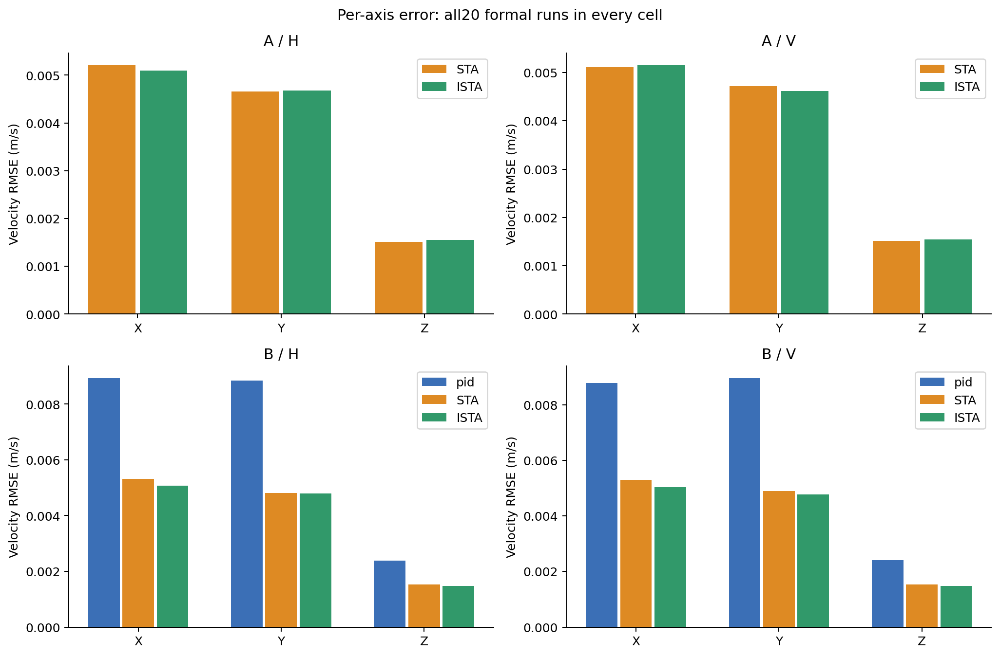
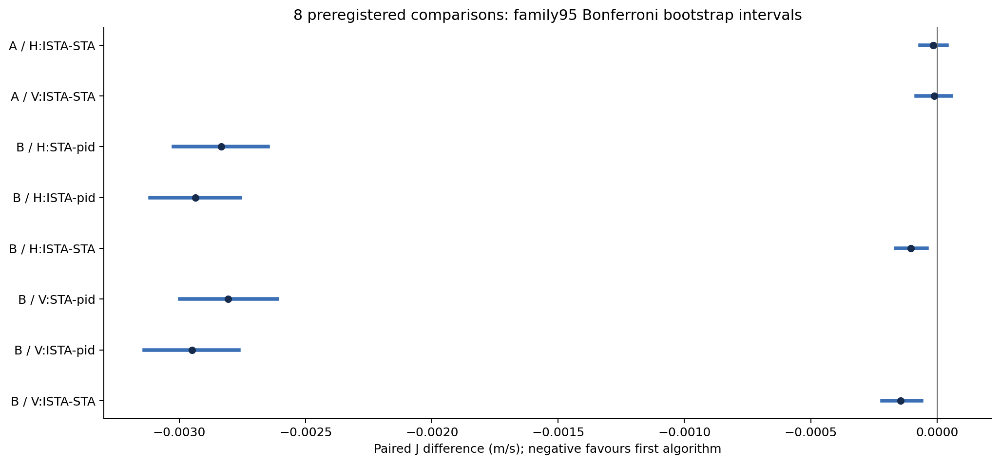
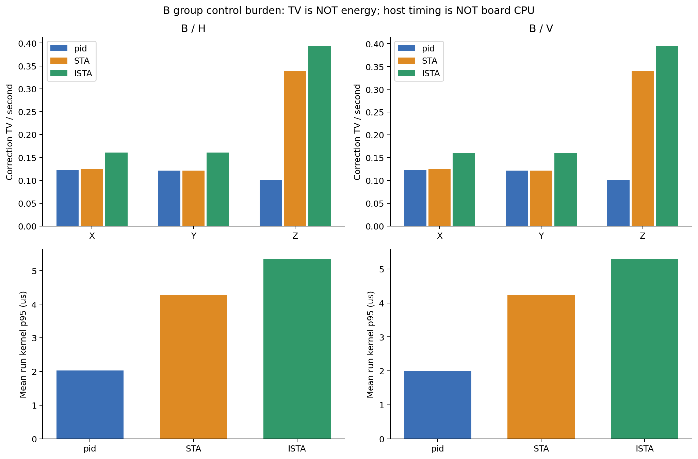

# RI07 正式比较结果与复算入口

范围仅为 Iris Gazebo SITL 的 XYZ 速度环：图中 `pid` 是原速度 PID，`STA` 是 MODE3 的 R-STA，`ISTA` 是 MODE4 的补偿正则化 R-ISTA。原位置 P、姿态及角速度 PID、DIV1 保持不变；不是实机验收。

最终验收状态以 [RI07 报告](../../../../reports/RI07.md)、`package.json`、`audit.json` 和外部 `FORMAL/gate_pass.json` 为准。原始 ULog 不放入 Git。

快速阅读：[简明中文总结](SUMMARY_CN.md)。

## 两类比较不能混合

- A：STA / ISTA 使用共同基准参数，H、V 各20个配对块，共80轮。差异还包含补偿预测，不是单纯 Euler 离散化效应。
- B：pid / STA / ISTA 使用 RI06 各自等预算选出的参数，H、V 各20个配对块，共120轮。搜索只涉及三个统一增益倍率，不代表找到了每种算法的最优参数。
- H：固定 yaw 水平8字；V：同一水平轨迹叠加小幅平滑升降。两任务使用同组20块，不能当成40个独立种子。A/B、训练和验证种子分离。

主指标 `J=(RMSE_X+RMSE_Y+RMSE_Z)/3`，单位 m/s，来自64秒主窗口内实际速度与控制器实际消费速度目标之差，逐轴按时间加权；两个32秒半窗单独保留。原位置 P 仍工作，因此相同外部轨迹不意味着内部速度目标逐样本相同。

## 图表

图中的柱为各配置全部20轮均值，不挑选最好的一轮。第三张图的横线是配对差置信区间，灰色竖线是差值0的参考线，不是第四种控制算法。








TV 统计基于真实更新，不等于能耗；宿主墙钟耗时不等于飞控板 CPU 占用。位置、任务 Z 目标误差、相对2.5m高度偏离、yaw、限制、频谱和逐轮耗时均在结果包中，不只报告 J。

纠偏TV/s是加速度纠偏累计变化量除以时间，量纲为 `(m/s²)/s`；归一化推力TV/s量纲为 `1/s`。前者不是直接测得的机体实际jerk，二者都不能当成电机耗电量。

## 保存内容

- `package.json`：200轮指标、10类完整127参数配置、400份原始 ULog 路径/字节数/SHA-256、8项主比较及95%和家族校正区间。
- `audit.json`：从原逐轮指标重建配对矩阵、复算固定随机种子统计、核对原始指纹的结果；这不是新飞行。
- `commands.json`：本次结果收尾命令、退出码及外部日志指纹。
- `collect.py` / `audit.py` / `plots.py`：只读结果收集、复算和制图；不调用起飞、调参或重新选参。
- `test_collect.py`：36项合成结果层测试，不作为控制器单测数量。
- `parallel_replay.py` / `test_parallel_replay.py`：最多4路只读解码及7项编排测试。每轮仍实际调用原冻结分析器，完成后用原冻结整批验证器验收；不修改任何时间、模式、数值或配对规则。

全部原始数据位于：

```text
/home/yr/Desktop/codev doc/experiments/VELOCITY-RISTA-20261026/RI07/FORMAL/
  qualification01/       干净源码构建、实际回归及新固件资格
  batch01/               A001…A080、B081…B200及唯一执行ledger
  replay01/              每轮推进前的独立子进程回放与收据
  replay02/              顺序额外回放，61轮后主动中止以改用有限并行；记录保留
  replay03/              从头完整200轮的并行只读回放和全输入前后指纹
  gate_pass.json         整批回放/80项配对风险检查完成收据
  results01/             首次汇总失败：误将窗口长度等同采样权重和；原日志保留
  results02/             首次成功导出及审计；原包/原图完整保留
  results03/             图1增加留白后的最终测试、汇总、复算、制图命令日志
```

`execution.json` 和原 RI06 package 的 `unattempted/flight_authorized=false` 是不可改写的预注册快照，不是实际结果状态；实际结果以新 ledger、资格和最终包为准。第二次日志回放不增加样本，仍为200次实验，而不是400次。

## 离线复算

不要再次执行原正式飞行清单：它的200次预算和种子已经使用。下面只分析已有数据；输出路径必须不存在。

冻结检查仍拒绝范围外改动。收尾会恢复用户原有、未提交的 `ri06/results/plots01`，因此日后整链复算前应先将该目录按指纹妥善另存，使检查范围满足原条件，完成后恢复；不得用 `git clean` 删除它，也不得为了复算放宽冻结检查。生产源码、模型和外部依赖必须保持与冻结清单一致。

```bash
cd /home/yr/Desktop/Codev-autopilot
export PYTHONDONTWRITEBYTECODE=1
export PYTHONPATH="$PWD/.px4-python:$PWD/research/sta-velocity-control/scripts:/home/yr/Desktop/codev doc/experiments/M00-20260912/python:/home/yr/Desktop/codev doc/experiments/M10-20260917/plot_dependencies01/python"

# 复核已有整批回放，重新生成指标/统计包；输出请使用新的文件名。
python3 -B research/sta-velocity-control/regularized_ista/ri07/results/final01/collect.py \
  --replay '/home/yr/Desktop/codev doc/experiments/VELOCITY-RISTA-20261026/RI07/FORMAL/replay03' \
  --output '/tmp/ri07_recomputed_package.json'

python3 -B research/sta-velocity-control/regularized_ista/ri07/results/final01/audit.py \
  --package '/tmp/ri07_recomputed_package.json' --output '/tmp/ri07_recomputed_audit.json'

python3 -B research/sta-velocity-control/regularized_ista/ri07/results/final01/plots.py \
  --package '/tmp/ri07_recomputed_package.json' --output '/tmp/ri07_recomputed_figures'

# 如需再次从ULog独立解码，使用全新的目录；已有gate_pass不覆盖，故不加--finalize。
python3 -B research/sta-velocity-control/regularized_ista/ri07/tools/replay.py \
  --gate FORMAL \
  --output '/home/yr/Desktop/codev doc/experiments/VELOCITY-RISTA-20261026/RI07/FORMAL/replay04'
```

重采样使用冻结的 `ri06/statistical_plan.py`：20万次 bootstrap，种子86001，组内H/V共享块索引；8比较 Bonferroni 家族95%区间。探索性符号翻转10万次、种子86002，不替代主区间。最小实用差为0.0005m/s；统计差异和实际价值不能混为一谈。缺失不填0，本次是否缺失以最终包为准。

窗口是按激励时间选择的 `[0,64)`、`[0,32)`、`[32,64)`；冻结分析器对这些样本使用完整sensor时间间隔作权重，不裁切最后一个间隔。故3轮的主窗权重和为64.004秒，而不是恰好64秒；这不是把任务加长或放宽日志规则。结果包分别保留名义窗口和实际权重和，原指标/分析器不变。首次汇总层错误断言和exit1已保留，修正后重新导出不算补飞。

原始 p/理想输出/候选 nu 与受保护的应用输出、应用 nu、发布推力分别记录并审计；不能将受限或冻结后的结果当成严格隐式理论解。只有 IMU 创新显式播种，其余随机源和宿主调度没有完全控制。参数、任务、模型以外的泛化效果和实机结论均未验证。

注意嵌套诊断的层级：沿用RI02的ISTA数学组件返回 `component_valid=true, flight_accepted=false`，表示该组件本身不授予完整飞行验收；整轮结论由上层完整分析链的 `accepted`、`result.success` 和最终ledger共同给出。不要将组件标志单独当作本次起降失败，也不要仅凭组件通过就宣布飞行通过。
