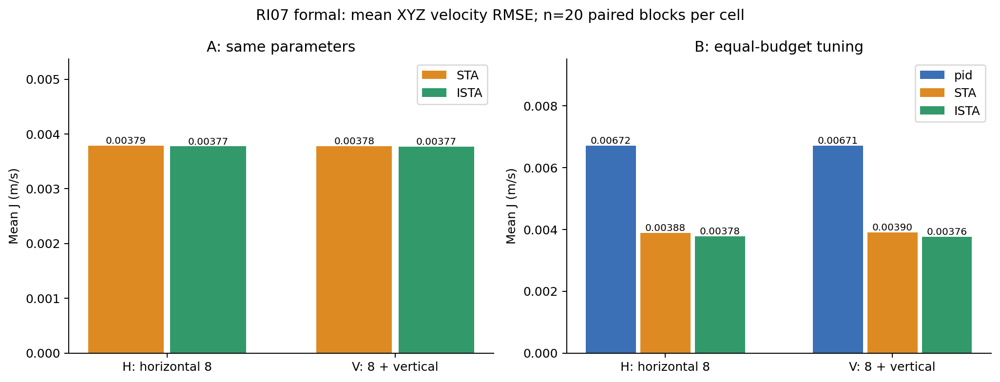

# RI07 简明结果：pid、STA、ISTA 的 XYZ 速度环比较

本次完成 **200轮 Iris Gazebo 仿真，200轮接受，无失败、无补飞、无缺失**。每轮都有起飞、任务、降落上锁及独立日志回放。STA指正则化R-STA，ISTA指补偿正则化R-ISTA；不是旧ESTA或Proper-ISTA。最终复核和提交状态见[完整报告](../../../../reports/RI07.md)。

## 做了什么

只比较XYZ速度环算法，位置P、姿态环、角速度PID和100Hz左右的实际速度更新频率保持。任务有两种：H是固定机头方向的低速水平8字；V在同一水平轨迹上增加平滑小幅升降。不是风扰、质量变化或实机实验。

- A组80轮：STA和ISTA使用相同的基准参数，研究算法形式差异；差异也包含补偿预测，不能简单称为只比较显式/隐式Euler。
- B组120轮：pid、STA、ISTA使用上一阶段相同训练预算选出的参数。正式实验中不再调参，也不挑最好的一轮。

每种任务、每种算法、每组均有20轮。主指标J是X/Y/Z三轴速度RMSE的平均，单位m/s、越小越好；每轴比较的是“控制器实际使用的目标速度”和“估计的实际速度”，不是位置误差。统计窗口是每轮64秒任务段。

## 结果怎样

| 组/任务 | pid J | STA J | ISTA J |
| --- | ---: | ---: | ---: |
| A / 水平8字 | — | 0.00378945 | 0.00377445 |
| A / 8字加升降 | — | 0.00378065 | 0.00377007 |
| B / 水平8字 | 0.00671805 | 0.00388493 | 0.00378092 |
| B / 8字加升降 | 0.00671138 | 0.00390464 | 0.00376112 |

**B组中，两种STA的综合速度误差比pid低约42%–44%。** ISTA比STA再低约2.7%和3.7%。八项预注册比较采用配对统计和多重比较校正，B中ISTA−STA的区间低于0，但其绝对改善约0.00010–0.00014m/s，**小于事先规定的0.0005m/s实用差**，不能夸大成明显工程优势。

**A组同参数时，ISTA与STA的误差差异不明确：校正区间包含0。** 所以这次实验不能证明“隐式算法天然更准确”。

## 代价和边界

B组ISTA的平均纠偏输出变化量TV/s比STA高约22%，宿主核路径耗时也更高。TV不是能耗，宿主耗时不是飞控板CPU负载。A组ISTA输出反而更平滑；不能拿A组的平滑性和B组的误差改善拼成同一套参数的优势。

位置、高度和机头误差没有跟着速度J同比改善。相同外部轨迹经过位置P后，各算法的内部速度目标可能不同；V任务相对固定2.5m的高度偏离还包含有意升降。

只有IMU创新显式播种，同一组H/V共享20个配对块；其他随机源和宿主调度未完全独立控制。结论仅适用于已冻结的参数、模型和这两种小幅仿真任务，不保证强扰动、其他频率或实机也更好。

一句话：**在本次公平调参后的仿真里，STA和ISTA都明显降低了PID的速度跟踪误差；ISTA比STA只多改善一点，而且输出变化更大。**

[全部图表、指标与离线复算说明](README_CN.md) · [完整报告与统计区间](../../../../reports/RI07.md)
