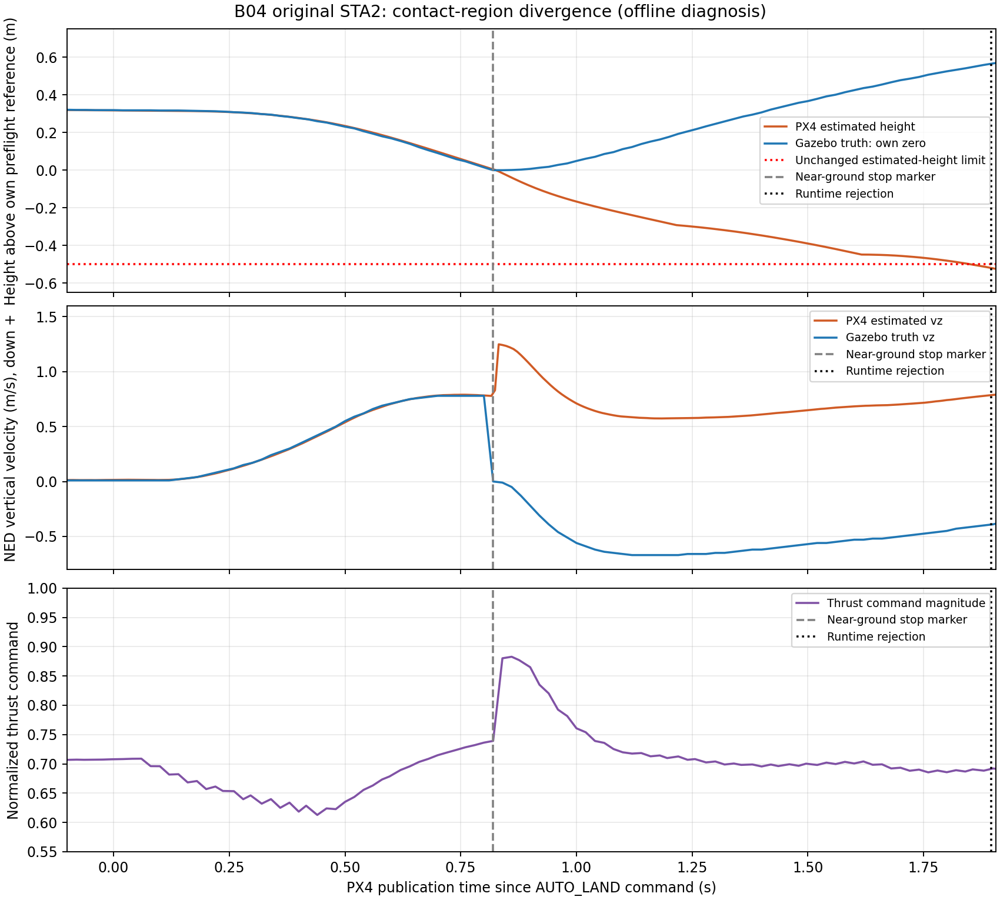
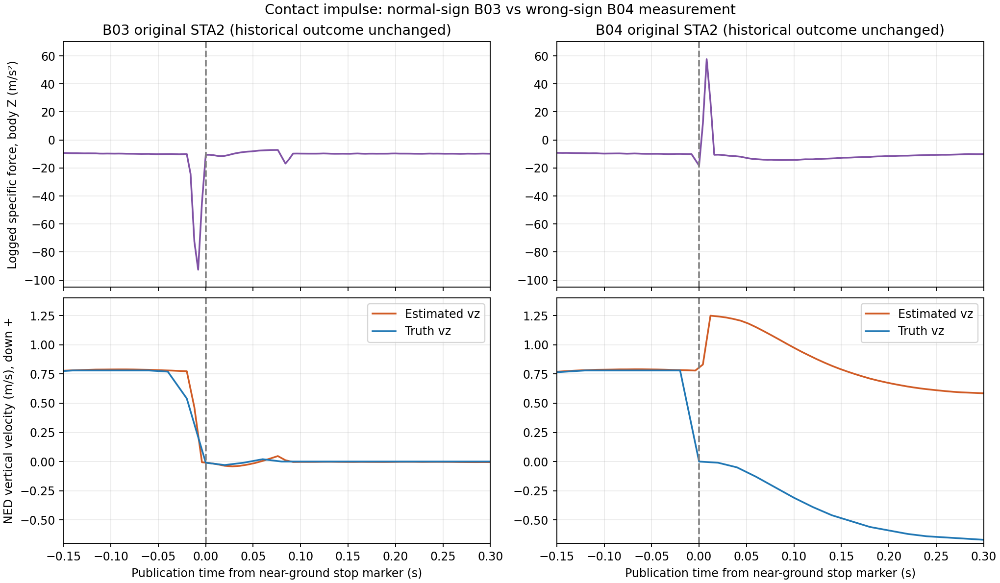

# 原版 STA2 接地与高度估计离线审计

2026-11-02。**接地附近，估计速度与仿真真值发生了明显分离；这不是仅由高度零点、ROS 目标发布或结束采样不新鲜造成的误报。最强线索是原版仿真 IMU0 的未检查浮点转 int16 转换：冲击可能变成反方向加速度，且没有饱和提示。** 原始转换前报文未保存，因此不能称本次飞行的唯一根因已逐报文证实。

本次仅离线诊断，新增飞行为 0。未修改控制律、参数、模型、运行器、安全阈值或旧结果；未提交、未 push。B04 仍为 2 次尝试、1 次接受，四系统对比尚未完成。

## 接地时发生了什么

使用 B04/O002 原始 ULog。高度分别减去各自起飞前参考值；速度为 NED，正值表示下降，负值表示上升。真值采用不晚于查询时刻的最近发布记录，表中不作未来插值。

| PX4 时间 s | 阶段 | 估计相对高度 m | 真值相对高度 m | 估计 vz m/s | 真值 vz m/s |
| ---: | --- | ---: | ---: | ---: | ---: |
| 99.524 | AUTO_LAND 命令 | 0.31753 | 0.31900 | 0.01488 | 0.01000 |
| 100.324 | 接近地面 | 0.01993 | 0.01498 | 0.78350 | 0.78000 |
| 100.344 | 真值停止下降 | 0.00751 | 0.00000 | 0.77912 | 0.00000 |
| 100.364 | 冲击之后 | −0.01596 | 0.00000 | **1.24286** | **−0.01000** |
| 100.544 | 已重新上升 | −0.17743 | 0.06097 | 0.67967 | −0.59000 |
| 101.420 | 运行器拒绝 | **−0.51929** | **0.55899** | **0.78600** | **−0.40000** |

最后一行真值记录实际发布于 101.404 s，比查询早 16 ms。即使检查停止点前后 100 ms，真值相对高度仍在 **0.525–0.597 m**，与负 0.519 m 的估计显著不同；这项检查不是对未知通信延迟的保证。

估计高度首次低于冻结下限 −0.5 m 出现在 101.380 s，运行器于 101.420 s 拒绝。触发的是高度条件，不是 3.5 m/s 垂直速度上限。不能把这个估计值解释成无人机实际钻入地面半米。



橙线为估计，蓝线为仿真真值，紫线为归一化推力指令；灰虚线仅标记真值接近初始地面高度且停止下降的记录，红点线是原安全下限，黑点线是运行器拒绝时刻。标记不是接触传感器事件，推力指令不是实测电机力。

## 真值来源与时间口径

已检查原版 checkout 中的实际发布链，不把日志中名字带 `groundtruth` 的字段直接视为可同零点相减的量。

1. `gazebo_groundtruth_plugin.cpp:132` 起从 `model_->WorldPose()` 取位置，海拔为世界 Z 加 home altitude；不是 EKF 估计，也不是加噪 GPS 观测。
2. `gazebo_mavlink_interface.cpp:719` 起将缓存的真值经纬高放入 `HIL_STATE_QUATERNION`，速度来自模型 `WorldLinearVel()`，经 ENU→NED 变换。海拔量化到毫米，速度量化到厘米每秒。位置来自异步回调缓存，速度直接读取模型，不能宣称内部完全同时。
3. `SimulatorMavlink.cpp:527` 起，PX4 用首个真值海拔建立自己的高度参考，`z = alt0 − alt`。话题时间是收到报文时的 `hrt_absolute_time()`，未保存报文原始 `time_usec`，`timestamp_sample` 为零。

B04 起飞前估计参考 z 为 −0.01047 m，真值参考 z 为 +0.7259827 m。**两者约 0.73645 m 的原始零点差不是动态估计误差**；本审计各减各的参考值后再比较。仅用发布时钟做因果匹配，未把真值的零 `timestamp_sample` 当作有效采样时钟，也未移动曲线去人为对齐峰值。

降落窗口估计位置日志间隔 8 ms，真值位置间隔 20 ms；`sensor_combined` 中位间隔 4 ms、最大间隔 8 ms，其积分字段为 4 ms。ULog 无 corruption、无 dropout，但这不代表所有原始 IMU 样本均被记录。因此不使用缺样序列冒充精确冲击面积。

原 `empty.world` 同时包含地平面和厚 0.1 m 的 asphalt box；Iris 机身碰撞盒厚 0.11 m，接触 `min_depth=0.001`。按插件默认 home altitude 488 m 反推，100.344 s 机体中心世界高度约 0.10403 m，与 `0.05+0.055−0.001≈0.104 m` 的接地几何相符。日志未保存完整进程继承环境或物理接触力，此几何核对是条件性佐证，不是精确碰撞力重建。更直接的证据是自身起飞前高度附近真值下降速度骤降到零，随后高度上升。

## IMU 转换的异常证据

原版 [SimulatorMavlink.cpp](/home/yr/Desktop/Codev-SuperTwisting2-original/src/modules/simulation/simulator_mavlink/SimulatorMavlink.cpp:206) 的 IMU0 路径：

```text
浮点加速度 / (9.80665 / 2048) → 直接赋给 int16 FIFO
→ PX4Accelerometer::updateFIFO → 后级积分与估计
```

可表示范围约 ±16g。转换前没有范围检查，越界浮点转整数不具有可移植的 C++ 行为。驱动只检查转换后的整数是否靠近端点；若已翻转到范围中间，`clipping=0` 并不能证明输入没有超量程。

本轮原始记录：

- 100.348 / 100.352 / 100.356 s，`sensor_combined.accelerometer_m_s2[2]` 为 **+11.688 / +57.640 / +27.394 m/s²**，clipping 均为 0。接地后飞机姿态仍接近水平，至停止最大倾角约 0.386°，不能用大姿态翻转解释该符号。
- 100.324→100.364 s 的估计与真值垂直速度差增加 **1.24937 m/s**；一个 4 ms 样本发生一次 16 位绕回的面积差为 `65536 × (9.80665/2048) × 0.004 = 1.25525 m/s`。数值高度接近，**不是由此反推出本轮精确原始冲击值**。
- 本次独立 C++14 表达式探针使用合成 −200 m/s²，在本机普通构建中得到 **+113.816 m/s²、clipping=0**；正 200 得到负 113.816。开启 float-cast-overflow 检测后，这两个越界输入均被检出并退出 1。−9.80665 和 −100 的范围内输入正常。合成 −200 不是本轮飞行实测峰值，探针也不是完整固件重放。

旧 [V04 IMU0 链审计](../../sta-velocity-control/reports/V04_IMU0_CHAIN_AUDIT.md) 已通过当时真实 Simulator→驱动→VehicleIMU 验证同类缺陷；本次只读核对该历史证据，没有冒充重新运行其完整夹具。当前主仓库已保留当年的[范围检查修复](../../sta-velocity-control/reports/V04_IMU0_CHAIN_REPAIR.md)，而原版 STA2 checkout 的转换仍未修复。这解释了为什么原样复现仍可能遇到主工程之前处理过的问题；两套系统的仿真适配层并不相同。

## 为什么没有判定落地

接地后首 400 ms，归一化推力指令峰值约 **0.883**，高于接地前约 0.73；真值随后上升。这与错误的“仍快速下降”估计驱动控制器增推力的链条一致，但不能仅凭时序隔离控制 P/I/D 各项因果，也不能认定全部回弹都来自碰撞弹性。

原 land detector 并不直接读取 Gazebo 碰撞。它要求低推力、低垂直运动及其他条件同时成立。末次状态为 `has_low_throttle=false`、`vertical_movement=true`、`ground_contact=false`、`landed=false`，与其源码规则一致；因此物理短暂接地不保证软件已经确认落地。不能通过强制 landed 或放宽高度下限来代替修复。

飞行期间 XY/Z/速度 reset 计数不变，主 EKF 为实例 0，没有对应的估计器切换。GNSS/气压融合仍有记录，GNSS 垂向速度创新从接地前约 0.109 增至随后约 1.007、1.266 m/s，说明估计和观测存在分歧；不能称为 GPS 完全断流。本轮未重放 EKF 内部状态，未确定每个修正项的贡献。

还需区分算法名称：原版 STA2 的 Z 速度实际输出仍为 PID，`PositionControl.cpp:163` 的 Z STA 输出赋值被注释。本次问题**不是“已经证明 Z 速度 STA 控制律不好”**，更不能作为 RSTA/RISTA 性能排序。

## 旧完整降落日志的对照

另读取 B03/O002 原始 ULog，作为同一原版系统的历史诊断对照，不补本批样本、不改其日志验收失败：

- 接地冲击记录为负向，窗口最低约 **−92.601 m/s²**；随后估计速度和真值都接近零，最终 landed/disarmed。
- B04 对应窗口出现正向 **+57.640 m/s²**，之后估计速度与真值长时间反号。
- 两份日志均无 ULog corruption/dropout。B03 的历史失败仍然保留，不能以本对照改称旧批次通过，也不能用两轮数据估计故障概率。



## 实际验证与保存范围

[完整机器可读证据](results/contact_audit01/audit.json)、[只读复现脚本](results/contact_audit01/audit_contact.py)、[14 项测试日志](results/contact_audit01/tests_final.log)。原 ULog 保留外部 experiments 目录，仓库仅保存小摘要和两张图。

- 新增对齐/零点/缺样语义测试 **14 项**通过，exit 0；重复运行不累加数量。
- 两份真实 STA2 ULog 离线解码，两个编译配置、八次合成输入执行；其中 sanitizer 两次预期 exit 1 是检出旧转换缺陷，不是飞行或安全验收通过。
- 最终 `analysis04` 审计 exit 0；**391 个原证据/源码/固件路径前后 SHA-256 不变，包括 B04 的全部 314 项冻结资产**。
- `analysis01/02` 为早期成功诊断；`analysis03` 在读取 B03 已落地后的可选 HTE 时因数据过期退出 1，随后复制步骤也失败，未覆盖任何旧文件。最终显式记录该可选诊断缺失，不延长时间阈值、不把缓存称为新数据，并补充测试。各目录保留。
- 未执行新的生产 C++ 控制回归、整机固件构建、完整 EKF 回放、MATLAB、飞行或实机；本轮没有生产修改，不引用旧 425 项测试为本次重跑数量。

最终复现命令（输出目录必须不存在，防止覆盖证据）：

```bash
cd /home/yr/Desktop/Codev-autopilot
export PYTHONPATH="$PWD/.px4-python:/home/yr/Desktop/codev doc/experiments/M00-20260912/python:/home/yr/Desktop/codev doc/experiments/M10-20260917/plot_dependencies01/python"
python3 -B -m unittest discover \
  -s research/upstream-supertwisting2/offboard/results/contact_audit01 -p 'test_*.py' -v
python3 -B research/upstream-supertwisting2/offboard/results/contact_audit01/audit_contact.py \
  --output '/home/yr/Desktop/codev doc/experiments/UPSTREAM-STA2-CONTACT-AUDIT-20261102/reproduce01'
```

实际输出为同一父目录下 `analysis04`；上面的 `reproduce01` 是未来复现位置，未执行。主仓库 HEAD `1f6fe1c7a46c22ea41a6a6a51c51498142ca6d62`、原版 HEAD `fc3720f67767c78cfab668777de13f68562fe2fd`。原版 Gazebo 子模块 `70683dc759cbd3ebccfa78429b564f8b1fb5d149`，既有 `.gitignore` 修改保留，不宣称工作区完全干净。完整源码、固件及日志指纹见 JSON。

## 下一步边界

建议保留当前原样 STA2 快照及失败，另行限定一个**只修仿真 IMU 加速度转换、不改 STA 控制律**的版本，先做真实转换链与范围内等价回归。需明确修复只防止反号和漏报，限幅仍会损失冲击面积，不能保证一次修复就完成降落。

该版本必须标注为“原 STA2 控制律＋仿真适配修复”，不能再称整个系统字节级原样。之后若获准飞行，再冻结新固件、工具和有限批次；不续用已关闭的 B04，不改历史判定，不改安全阈值。本次停在离线诊断，没有实施上述修复。
