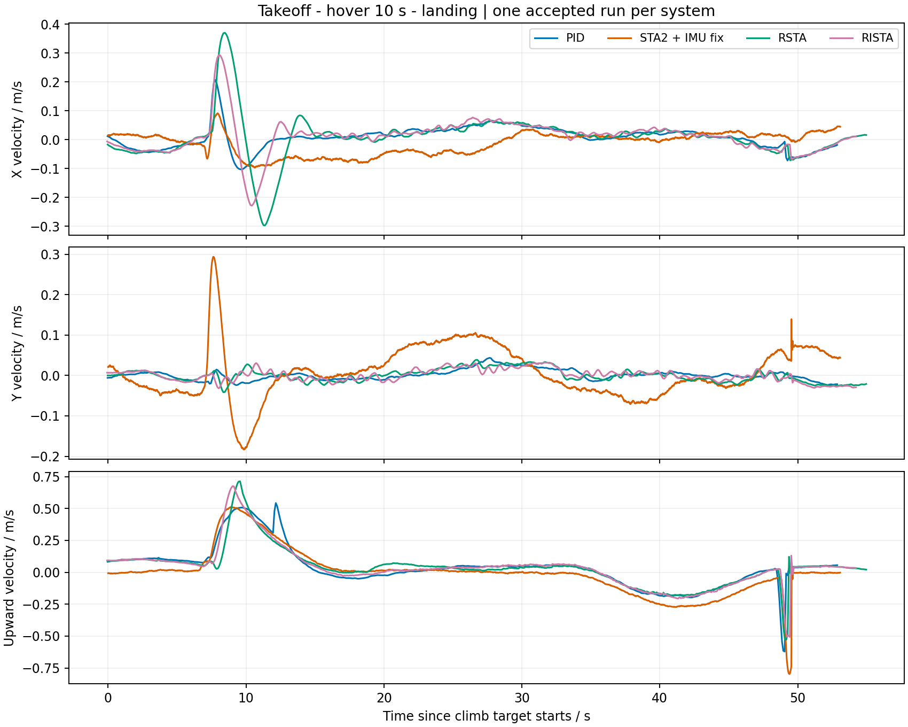
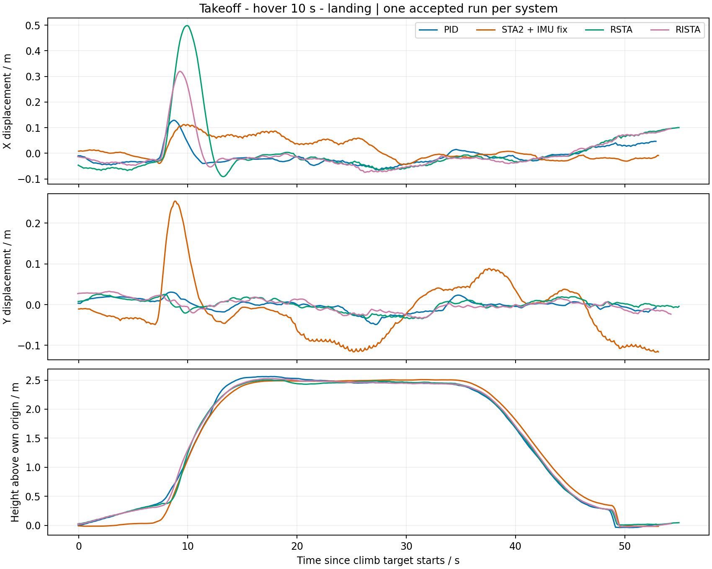

# IMU 修复版起降验证与四系统对比结果

2026-11-02。**完成全部 5 次授权尝试，5 次接受，没有补飞、调参或放宽阈值。** 先完成 STA2 修复版一次接地门，再完成 PID、STA2 修复版、RSTA、RISTA 各一次同任务比较。所有原始 ULog 已重新解码核对，参数精确恢复，无残留仿真进程。实验完成时尚未提交或 push；后续归档范围见文末。原版 STA2 快照未改动。

本次证明这些固定配置能完成这一简单 SITL 任务，不证明实机安全或某算法普遍优于其他算法。STA2 是原上游控制律加仿真 IMU 适配修复；RSTA/RISTA 是本项目速度环算法，两者不是只改同一控制环的纯算法消融。

## 做了什么

原 12 项 PositionControl 单测失败来自测试未初始化新增归一化参数：XY 分母限值为零，使零误差出现 0/0。只在测试夹具补齐真实模块使用的原默认参数及积分 reset，未改原断言，原 16 项与新增 1 项全部通过。控制实现没有为使测试通过而修改。

生产改动仍只限 `SimulatorMavlink.cpp/.hpp` 的加速度转换修复，保持原 STA 控制律、增益、驱动积分、估计器、模型、land detector 和起降逻辑。修复工作树为 `/home/yr/Desktop/Codev-SuperTwisting2-imu-fix`，分支 `research/sta2-sim-imu-fix`。主研究仓库仍为 `research/upstream-supertwisting2`，原有未提交文件保留。

完整[冻结协议](../quick_check/PROTOCOL_CN.md)和[离线修复报告](../imu_conversion_fix/README_CN.md)可追溯。固件与前次离线构建相同，SHA-256 为 `71a3e620864fa1f00c9b3d43230146cda88237e2a6f7c7c56e2cbf09a39cbed4`，额外测试初始化不改变固件。

## 任务及接地门

真实 ROS 发布/订阅 → 本机 MAVLink → PX4 Offboard。每次独立重启和 30 秒原生日志预热；16 秒平滑位置目标升至相对 2.5 m，稳定后悬停 10 秒，再经稳定检查、16 秒降到 0.3 m，最后 AUTO_LAND、落地上锁。固定 yaw、不发送加速度 FF，主栈角速度环为 PID。没有新增阶跃、速度脉冲或 8 字任务。

首轮 STA2 接地门结果：最后 0.5 秒尾窗有 63 个估计样本，真值因果匹配最大年龄 16 ms。高度估计与各自零点对齐的真值最大差 **0.0916 m**，垂直速度最大差 **0.0161 m/s**，分别满足预先冻结的 0.3 m 和 0.2 m/s 条件。落地期 sensor_combined Z 加速度为 −84.70～−7.27 m/s²，clipping=0、积分周期 4 ms。

本次冲击未触发 clipping，因此它证明本任务能正常接地，不是原超量程输入的精确实飞回放，更不能证明历史高度异常只有一个原因。超量程转换修复的方向与标志正确性仍由实际源码离线负对照支撑。原失败保留，不改判。

## 四系统实际速度与位移

每个子图只有四条实际状态曲线，没有目标虚线。速度和位移分图，时间零点统一为各轮 `climb_start`，不按各自运动起点二次平移。X/Y 为本地 NED 轴；为直观显示，Z 取反画成向上速度与相对起始高度。数据是 PX4 估计值，不是仿真真值。





可编辑矢量图：[速度 SVG](results01/actual_velocity_xyz.svg)、[位移 SVG](results01/actual_displacement_xyz.svg)。

## 响应速度怎么比较

以下均为这一轮的实测任务响应。目标是 **16 秒平滑爬升**，不是理想位置阶跃；不能把结果直接当控制器带宽。

| 系统 | 命令起点至 90% 高度 s | 10%→90% 爬升时间 s | 爬升及悬停最大超调 cm | 进入稳定悬停记录 s |
| --- | ---: | ---: | ---: | ---: |
| PID | 12.852 | 7.892 | 6.12 | 19.152 |
| STA2＋IMU 修复 | 13.760 | 5.680 | 0.89 | 19.352 |
| RSTA | 13.368 | 8.500 | 0.19 | 19.268 |
| RISTA | 13.428 | 8.400 | 2.53 | 19.308 |

**PID 最早达到 90% 高度。** STA2 的 10%→90% 用时最短，但它到 10% 高度就用了 8.080 秒，PID 为 4.960 秒，所以“中段爬升时间短”不等于“从命令开始最早到达”。四组悬停进入时刻也受到同一稳定等待规则约束。

原生位置采样中位间隔：STA2 约 8 ms，另三组约 100 ms；跨系统几十毫秒的差异不宜过度解读。数值采用首次观测越界及其前后样本区间，没有插值虚构精度，完整区间在 [summary.json](results01/summary.json) 中。

## 悬停误差与起飞代价

仅取各轮完整 10 秒悬停窗口。速度 RMSE 对比的是 PX4 实际发布的内部速度目标和实际估计速度，采用时间加权；不是位置误差，也不是仅以零速度为参考的 RMS。

| 系统 | X 速度 RMSE m/s | Y 速度 RMSE m/s | Z 速度 RMSE m/s | 三轴算术均值 m/s |
| --- | ---: | ---: | ---: | ---: |
| PID | 0.007580 | 0.007951 | 0.003032 | 0.006188 |
| STA2＋IMU 修复 | 0.012683 | 0.014051 | 0.002252 | 0.009662 |
| RSTA | 0.006322 | 0.003814 | 0.001281 | 0.003806 |
| RISTA | 0.004972 | 0.005502 | 0.001324 | 0.003933 |

本轮 RSTA/RISTA 悬停综合速度误差低于 PID，但不能据此说全过程都更好：起飞期 X 向最大绝对偏移，PID 约 **0.129 m**，RSTA 约 **0.498 m**，RISTA 约 **0.320 m**，STA2 约 **0.112 m**。均在原 2 m 安全界限内，差异仍如实保留在图中。这个任务没有主动激励 X/Y，不能当作完整水平跟踪性能试验。

每系统只有一个新样本；原版与主栈的模型、起飞状态机、日志频率及随机源不同，主栈使用既有开发 seed 93001。本次无置信区间、显著性或理论排序结论，也没有按结果重新调参。

## 测试和证据

- 离线 C++：IMU 14、PositionControl 17、ControlMath 9、Takeoff 2、RateControl 1、AttitudeControl 3，共 **46 项通过**，实际退出码均 0。
- Python：新入口 **287 项**、原 Offboard **343 项**通过；出图/结果准入另 **4 项**通过，均退出 0。
- 工具迁移时修正了一个历史夹具的绝对路径断言。第一次完整资格因未带已有 matplotlib 依赖路径而失败，`qualification01` 原日志保留；补齐路径后 `qualification02` 通过，没有安装新包或改验收规则。
- 接地门 1/1、对比 4/4 接受；5 份原始 ULog 全部保留且参数精确恢复。外部目录约 159 MiB，无新增失败飞行或预算偏离。
- 原版 15,336 个文件指纹、B04 的 314 项冻结资产以及主仓库原有 tracked diff 核对未变。`git diff --check` 通过；未提交、未 push。

外部数据：`/home/yr/Desktop/codev doc/experiments/UPSTREAM-STA2-QUICK-20261102`。

仓库证据：[全批核验](results01/evidence/verification.json)、[离线命令及退出码](results01/evidence/qualification.json)、[接地门清单](results01/evidence/contact_gate_manifest.json)、[四系统清单](results01/evidence/comparison_manifest.json)、[完整修复及测试补丁](results01/evidence/repair_source.patch)。每轮原始 ULog 路径及 SHA-256、参数、真实模式、指标、独立重解码结果均有索引。

实际执行入口：

```bash
# 已执行完毕，不要对这些 ID 再加 --execute；运行器会拒绝重复尝试。
cd /home/yr/Desktop/Codev-autopilot
export PYTHONPATH="$PWD/.px4-python:/home/yr/Desktop/codev doc/experiments/M00-20260912/python:/home/yr/Desktop/codev doc/experiments/M10-20260917/plot_dependencies01/python"
python3 -B research/upstream-supertwisting2/quick_check/qualify.py --name qualification02
python3 -B research/upstream-supertwisting2/quick_check/run.py \
  --manifest '/home/yr/Desktop/codev doc/experiments/UPSTREAM-STA2-QUICK-20261102/comparison/manifest.json' --job O001
# 不带 --execute 仅 dry-run，不发指令；已有资格目录拒绝覆盖。
```

只重画图可用 `quick_results/analyze_results.py --output <新的不存在目录>`，会重新解码四份真实日志并核对接受结果。不要用历史失败填补矩阵，也不要把这份单次结果当正式论文统计。

## Git 归档范围

本报告、图表、指标、日志指纹、IMU 修复证据和快速运行器归档到 `research/upstream-supertwisting2`；同时纳入运行器依赖的既有 Offboard 工具及失败记录、响应分析工具。未纳入本地主仓库其他速度环源码、手册或图表改动。原始 ULog 和固件仍在外部实验目录，不随 Git 上传。

实际 IMU 修复及测试在独立分支 `research/sta2-sim-imu-fix` 提交，完整 SHA 为 `0fe2bb361b99a4c8bccd4b1a70fa132f6e1cff90`，基于原版 `fc3720f67767c78cfab668777de13f68562fe2fd`，仅涉及报告列出的 5 个文件。两个分支的发布目标均为用户仓库 `i37532/CODEV`，不是上游作者仓库。

本次提交用于归档，不重新构建固件、不重新飞行。冻结清单中的旧 HEAD、源码文件指纹和 `committed: false` 等字段描述当时的实验状态，保持原样；不能把归档提交冒充为当时的干净构建版本。重新开展实验须重新核验并冻结版本，不能复用已执行清单。
