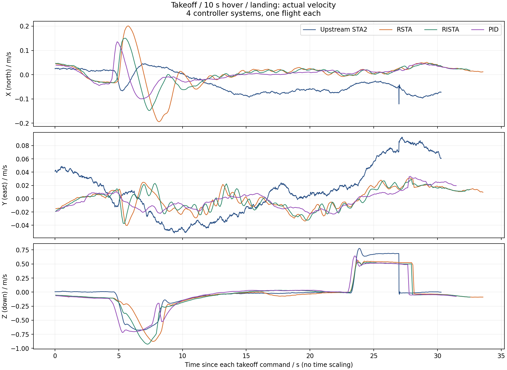
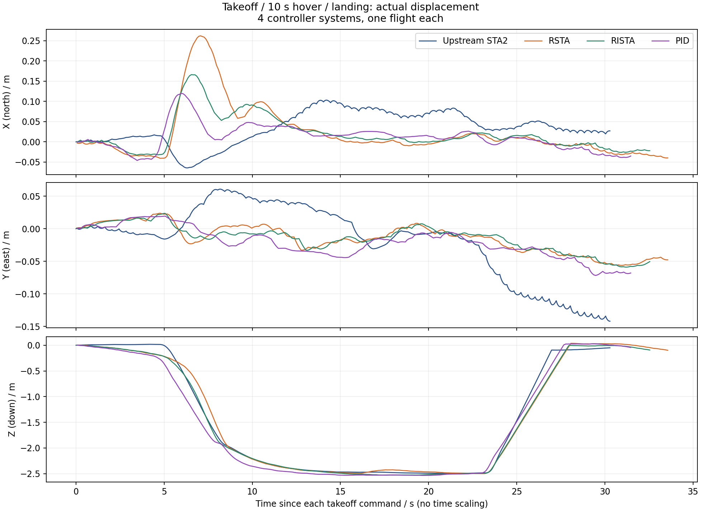

# Upstream STA2、RSTA、RISTA、PID 简易系统对比

这是不同完整控制系统的描述性对比，不是只替换速度环的公平算法消融。每个系统最多一轮（n=1），不能据此给出统计显著性、最优性或实机结论。

本轮悬停时，PID 的 X/Y 速度波动较小，RSTA 的水平位置偏移较小，PID 与 RISTA 的高度偏差几乎相同；这些指标衡量的不是同一件事，不能简单合成一个优劣顺序。

## 本次数据

计划 4 轮；实际有结果 4 轮；运行器通过 4 轮；完整可对比 4 轮。

本次比较使用的运行器结果、失败、缺失和 ULog SHA-256 保留在 metrics.json；本分析器不改判飞行结果。PID 扩展保留本实验已经完成的三轮，只新增一轮 PID，没有借用其他任务的飞行补样本。

速度是机载估计 vx/vy/vz；位移是估计位置减去各自起飞前最近样本，不是 Gazebo 真值或跟踪误差。NED 坐标：X北、Y东、Z向下。按起飞命令对齐，不平移峰值、不拉伸时间、不平滑。





速度与位移分图，每图 XYZ 三个子图，每轴仅 4 条系统实测曲线，无目标虚线。SVG 为可缩放版本。

## 10 秒悬停指标

速度 RMS 是相对零速度的波动量，不是相对各控制器内部目标的跟踪 RMSE。按实际采样间隔加权；高度偏差相对本轮起飞原点上方的约定高度。

|系统|运行器结果|X速度RMS|Y速度RMS|Z速度RMS|水平位移RMS|高度偏差RMS|最大倾角|
|---|---|---:|---:|---:|---:|---:|---:|
|Upstream STA2|通过|0.071641|0.015714|0.019117|0.080777|0.027845|1.342176|
|RSTA|通过|0.015924|0.015470|0.035504|0.019505|0.040454|3.419129|
|RISTA|通过|0.013713|0.015843|0.020555|0.020188|0.023557|3.105206|
|PID|通过|0.008722|0.013024|0.023487|0.031990|0.023547|3.053492|

速度单位 m/s，位移/高度单位 m，倾角单位度。倾角取完整起降区间；其余表内指标使用明确的10秒悬停窗。

metrics.json 另列起飞至悬停、起飞至上锁、降落命令至上锁耗时，以及原生消息双时钟、重复/倒退时刻、采样间隔、记录器 dropout 和 reset。间隔偏大不直接等同于已知丢失条数；没有 dropout 记录也不证明上游无漏采样。

若存在估计器位置/速度 reset，表内 coordinate_reset_warning 会标明；不偷偷补偿坐标跳变。缺少完整窗口时指标标记 missing。未新增安全阈值，也未将本次任务与历史正式统计合并。

## 配置与解释范围

PID 使用 RI07 B/H/PID 已选配置，不是出厂默认 PID：水平速度 P/I/D 为 2.376/0.528/0.264，垂直速度为 4.4/2.2/0。三种 CODEV 配置均关闭内部任务波形，保留位置 P、姿态与角速度 PID；原有 RSTA/RISTA 参数未改。没有为本轮重新调参。

原版 STA2 使用作者完整系统：三轴角速度 STA，水平速度为误差归一化 PID，垂直仍为 PID。它与 CODEV 的固件版本、控制分配和接触资产不同。原生位置日志频率分别为 STA2 125 Hz，其余三组约 10 Hz；线条平滑程度不能用于判断高频抖振大小。CODEV 三组使用相同 IMU 种子 93001，但不代表所有随机源一致，也不代表与原版完全配对。

此前两次工具启动失败均未解锁，记录仍保留；本次只追加一轮 PID，一次完成。累计六次启动、四次起飞、四次任务通过。57 项工具测试通过，四组 ULog 重新解码复算一致，旧三组指标与原始指纹不变。参数精确恢复、99 个原有文件未改、无残留仿真进程，核对记录见 [verification.json](verification.json)。未提交或 push。

## 复算

原始数据目录为 `/home/yr/Desktop/codev doc/experiments/UPSTREAM-STA2-HOVER-20261102`；清单 `manifest04_pid.json` 包含四个结果路径和指纹。S101/S202/S203 为保留的前三轮，S304 为新增 PID。旧三系统图片包不覆盖。

```bash
cd /home/yr/Desktop/Codev-autopilot
export PYTHONPATH="$PWD/.px4-python:/home/yr/Desktop/codev doc/experiments/M00-20260912/python:/home/yr/Desktop/codev doc/experiments/M10-20260917/plot_dependencies01/python${PYTHONPATH:+:$PYTHONPATH}"
python3 -B research/upstream-supertwisting2/tools/analyze_hover.py \
  --manifest '/home/yr/Desktop/codev doc/experiments/UPSTREAM-STA2-HOVER-20261102/manifest04_pid.json' \
  --output '/home/yr/Documents/UPSTREAM_STA2_PID_RSTA_RISTA_HOVER_REPLAY'
```

复算入口只读日志，不起飞；输出目录必须尚不存在。
